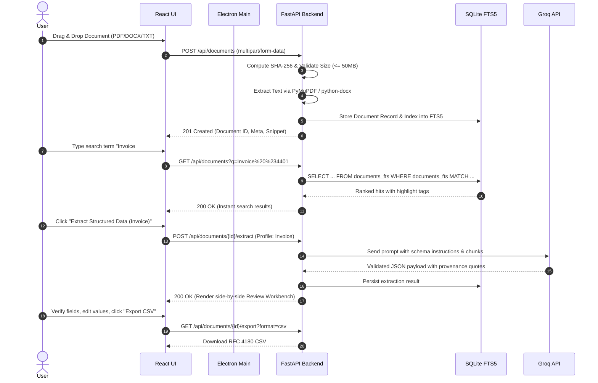

# Transformo Docs ⚡

> **Empowering Machine-Readable Document Management System**  
> *Built for PS #95 — Transforming unstructured documents into structured, searchable, and AI-ready assets with privacy-first local architecture.*

[-000000?style=for-the-badge&logo=apple&logoColor=white)](https://apple.com)
[](https://electronjs.org)
[](https://react.dev)
[](https://fastapi.tiangolo.com)
[](https://python.org)
[](https://sqlite.org)
[](https://groq.com)
[](file:///Users/shreyashgolhani/Desktop/transformo-docs-project/backend/tests)

---

## Table of Contents

1. [Executive Summary & Problem Statement](#-the-problem)
2. [The Transformo Docs Solution](#-the-solution)
3. [System Architecture](#-system-architecture)
   - [High-Level Architecture Diagram](#high-level-architecture-diagram)
   - [Component Breakdown](#component-breakdown)
   - [Data Flow Pipeline](#data-flow-pipeline)
   - [Security & Process Isolation Model](#security--process-isolation-model)
4. [Implementation Details & Phase Roadmap](#-implementation-details)
5. [Key Features Walkthrough](#-key-features)
   - [High-Speed Ingestion & Parsing](#1-high-speed-document-ingestion--parsing)
   - [Sub-Millisecond FTS5 Search](#2-sub-millisecond-fts5-search-engine)
   - [Map-Reduce AI Summaries](#3-map-reduce-ai-summarization)
   - [Schema-Enforced Structured Extraction](#4-schema-enforced-structured-extraction)
   - [Interactive Review & Export Engine](#5-interactive-review-workbench--export)
6. [Local Development & Setup Guide](#-local-development--setup)
   - [Prerequisites](#prerequisites)
   - [Step-by-Step Installation](#step-by-step-installation)
   - [Running in Development](#running-in-development)
   - [Testing & Quality Assurance](#testing--quality-assurance)
7. [Building the Standalone macOS DMG](#-building-the-standalone-macos-dmg)
8. [Configuration & Environment Variables](#-configuration--environment-variables)
9. [Privacy & Security Commitments](#-privacy--security-commitments)
10. [Known Limitations](#-known-limitations)
11. [Conclusion](#-conclusion)

---

## The Problem

Modern enterprises, legal teams, analysts, and researchers are drowning in unstructured documents: PDF reports, Word files, scanned receipts, contracts, resumes, and text notes. 

Despite advances in artificial intelligence, real-world document management remains fundamentally broken:

1. **Opaque File Silos:** Information is locked inside static binary containers (PDF/DOCX) that cannot be queried programmatically or sliced across dimensions without tedious manual copy-pasting.
2. **The Cloud Privacy Dilemma:** Most commercial document AI platforms mandate uploading confidential enterprise files to third-party cloud servers. For regulated industries (healthcare, legal, defense, finance), this violates strict privacy, GDPR/HIPAA mandates, and internal data security policies.
3. **Flaky Parsing & Hallucination:** Traditional OCR and basic regex parsers fail on complex layouts, while naive LLM extraction suffers from hallucinations, formatting discrepancies, and lack of verifiable provenance citations.
4. **Poor Desktop Experience:** Existing open-source tools are either raw command-line utilities inaccessible to non-technical staff, or heavy web apps requiring intricate Docker setups and constant internet connectivity.

---

## The Solution

**Transformo Docs** is an offline-first, native macOS desktop application engineered to turn unstructured documents into verified, machine-readable data pipelines. 

By combining the speed of native compiled libraries (PyMuPDF, SQLite FTS5) with the ergonomics of a sleek modern desktop interface (Electron + React) and the speed of Groq LLM inference, Transformo Docs gives users complete sovereign control over their knowledge base.

```
┌────────────────────────────────────────────────────────────────────────┐
│                        TRANSFORMO DOCS LIFECYCLE                       │
│                                                                        │
│   [PDF / DOCX / TXT]                                                   │
│            │                                                           │
│            ▼                                                           │
│   ┌─────────────────┐       ┌─────────────────┐       ┌────────────┐   │
│   │ Local Ingestion ├──────►│  SQLite FTS5    ├──────►│ Instant    │   │
│   │ & SHA256 Dedupe │       │  Full-Text Index│       │ Search     │   │
│   └────────┬────────┘       └─────────────────┘       └────────────┘   │
│            │                                                           │
│            ▼                                                           │
│   ┌─────────────────┐       ┌─────────────────┐       ┌────────────┐   │
│   │ Groq AI Engine  ├──────►│ Pydantic Schema ├──────►│ Clean JSON │   │
│   │ (Map-Reduce)    │       │ Provenance Link │       │ & RFC CSV  │   │
│   └─────────────────┘       └─────────────────┘       └────────────┘   │
└────────────────────────────────────────────────────────────────────────┘
```

### Core Value Pillars
- **100% Local Storage:** Documents, raw text, and metadata remain strictly on your Mac (`~/Library/Application Support/Transformo Docs/`).
- **Lightning Fast:** Sub-millisecond full-text search across thousands of indexed documents via SQLite FTS5.
- **Verifiable Provenance:** Every extracted field includes exact character offsets and source quotation snippets—zero unverifiable hallucinations.
- **Zero Data Leakage:** AI processing runs strictly on-demand after explicit user consent. No telemetry, no background network calls.
- **Zero-Config Packaging:** Shipped as a standalone macOS `.dmg` installer with an embedded Python runtime. No separate Python or Node installation needed by end users.

---

## System Architecture

Transformo Docs is designed with a **decoupled, multi-process architecture** separating UI presentation, native system orchestration, and heavy computational parsing.

### High-Level Architecture Diagram

```mermaid
graph TB
    subgraph macOS Environment
        subgraph Electron Application Container
            subgraph Renderer Process [React 19 Frontend - Vite + Tailwind]
                UI[Modern Responsive UI]
                DocView[Document Viewer]
                SearchBar[FTS5 Search Bar]
                ReviewBench[Review & Correction Workbench]
                ExportBtn[Export JSON / CSV]
            end

            subgraph Preload Layer [Context Isolation Bridge]
                Bridge[Secure window.electronAPI]
            end

            subgraph Main Process [Electron Node.js Core]
                ProcMgr[Backend Process Lifecycle Manager]
                TokenGen[Session Token Generator]
                PortFinder[Dynamic Loopback Port Allocator]
                WinMgr[BrowserWindow & Native Dialogs]
            end
        end

        subgraph Packaged Python Service [FastAPI Service on 127.0.0.1]
            AuthMid[Token Authentication Middleware]
            Router[REST API Endpoints /api/v1]
            IngestEng[Ingestion & Parser Engine - PyMuPDF & docx]
            FTS5Eng[SQLite Database & FTS5 Indexer]
            AISvc[Summarizer & Structured Extraction Service]
            ExportEng[RFC 4180 CSV & JSON Serializer]
        end

        subgraph Local Filesystem Storage [~/Library/Application Support/Transformo Docs]
            DocStore[Encrypted / Local Raw Document Vault]
            DBFile[(transformo.db SQLite WAL)]
            ConfigStore[config.json Settings]
        end

        subgraph External AI Cloud [On-Demand & User Consented]
            GroqCloud[Groq Cloud API - Llama 3.3 / GPT-OSS 120B]
        end
    end

    UI -->|React State & Calls| Bridge
    Bridge -->|ipcRenderer.invoke| MainProcess
    MainProcess -->|Spawns & Monitors| ProcMgr
    ProcMgr -->|Supervises Mach-O Executable| Packaged Python Service
    Bridge -->|Authenticated HTTP Requests with Bearer Token| Router
    Router --> AuthMid
    AuthMid --> Router
    Router --> IngestEng
    Router --> FTS5Eng
    Router --> AISvc
    Router --> ExportEng
    IngestEng --> DocStore
    FTS5Eng --> DBFile
    AISvc -->|HTTPS with User API Key| GroqCloud
```

### Component Breakdown

| Component | Technology | Responsibility |
|---|---|---|
| **Renderer Process** | React 19, Vite 8, Tailwind CSS 4, Lucide Icons | Displays document library, live FTS5 query results, side-by-side verification editor, and system configuration. |
| **Preload Bridge** | Electron `contextBridge` | Enforces `contextIsolation: true` and `nodeIntegration: false`. Exposes controlled IPC channels to the renderer without exposing raw Node APIs. |
| **Electron Main Process** | Node.js (Electron 44) | Manages application lifecycle, window state, dynamic port allocation, bearer token issuance, and child process lifecycle (graceful SIGTERM/SIGKILL). |
| **Backend Service** | Python 3.11/3.12, FastAPI, Uvicorn | High-throughput async REST server listening strictly on `127.0.0.1`. Executes file hashing, text extraction, database queries, and AI prompt engineering. |
| **Document Parsers** | PyMuPDF (`fitz`), `python-docx` | Fast C-backed PDF text extraction, scanned PDF heuristics, and Word document paragraph/table traversal. |
| **Database & Search Engine** | SQLite 3 (WAL mode, FTS5) | Stores document records, metadata, extraction schemas, and full-text index with BM25 ranking and highlighted snippet generation. |
| **AI Inference Client** | Official `groq` Python SDK | Executes map-reduce summarization and structured schema extraction using ultra-fast LLMs (`openai/gpt-oss-120b`). |

### Data Flow Pipeline



### Security & Process Isolation Model

- **No Remote Web Content:** The renderer strictly loads local built assets (`file://` or Vite dev server). No arbitrary remote code execution is possible.
- **Loopback-Only Binding:** The FastAPI backend binds exclusively to `127.0.0.1` on a dynamically assigned port, preventing any external machine on the local network from accessing the API.
- **Session Bearer Authentication:** At startup, Electron generates a cryptographically secure 256-bit random hex token passed to the backend via standard input. Every HTTP request from the frontend must include this token in the `Authorization: Bearer <token>` header.
- **Token Redaction:** Electron's process output logger automatically redacts the session token from stdout/stderr to prevent accidental exposure in log files.
- **Data Protection:** No documents or extracted texts are sent to the cloud without explicit per-action user initiation and privacy policy acknowledgement.

---

## Implementation Details

The development followed a rigorous, 9-phase software engineering lifecycle:

| Phase | Title | Scope & Highlights | Status |
|:---:|---|---|:---:|
| **01** | **Desktop Foundation** | Electron shell, React 19/Vite setup, Python FastAPI backend lifecycle manager, loopback port binding, dynamic bearer token handshake, health check probe. | ✅ Complete |
| **02** | **Ingestion & Text Extraction** | Multi-format ingestion (PDF, DOCX, TXT), 50MB file size safeguard, SHA-256 content deduplication, PyMuPDF C-engine parsing, scanned PDF detection, UTF-8 normalization. | ✅ Complete |
| **03** | **Document Library & FTS5** | SQLite WAL mode database, FTS5 virtual table indexing, Porter stemming, BM25 relevance ranking, snippet highlighting (`<mark>` tags), filtering by format, date, and status. | ✅ Complete |
| **04** | **AI Summarization** | Groq API integration (`openai/gpt-oss-120b`), map-reduce chunking for large documents, caching by document hash, user consent gate, rate limit and timeout backoff. | ✅ Complete |
| **05** | **Structured Data Extraction** | 3 Pydantic schema profiles (General Document, Invoice/Receipt, Resume/CV), byte-offset character provenance citations, field-level confidence scores. | ✅ Complete |
| **06** | **Review Workbench & Export** | Side-by-side visual verification workbench, editable fields, missing-value alerts, user verification state flags, RFC 4180 CSV export with schema flattening, and structured JSON export. | ✅ Complete |
| **07** | **Hardening & Quality Assurance** | Comprehensive test suite (76 automated backend tests with pytest), ESLint + Vitest frontend checks, memory leak prevention, orphan process cleanup. | ✅ Complete |
| **08** | **macOS Packaging & DMG** | PyInstaller standalone Mach-O executable bundle, electron-builder macOS arm64 target, DMG creation with drag-to-Applications layout, exclusion of dev files. | ✅ Complete |
| **09** | **Audit & Submission Verification** | Final clean-room audit, verification of DMG integrity, submission guide creation (`docs/SUBMISSION_GUIDE.md`), zero-leakage check of secrets or internal prompts. | ✅ Complete |

---

## Key Features

### 1. High-Speed Document Ingestion & Parsing
- **Format Support:** Native extraction from `.pdf`, `.docx`, and `.txt` files.
- **Deduplication:** Automatic SHA-256 fingerprinting prevents redundant storage and re-indexing of identical files.
- **Scanned PDF Heuristics:** Automatically calculates character-to-page density ratios; warns users when a PDF contains only scanned bitmap images without an embedded text layer.
- **50 MB File Size Guardrail:** Enforces strict upload limits to protect system memory and prevent denial-of-service from corrupt or hostile files.

### 2. Sub-Millisecond FTS5 Search Engine
- **SQLite FTS5 Core:** Leverages SQLite's native full-text search engine in Write-Ahead Logging (WAL) mode for concurrency.
- **Intelligent Querying:** Supports prefix searches, boolean operators (`AND`, `OR`, `NOT`), and phrase queries.
- **Snippet Highlighting:** Returns contextual match snippets with highlighted markup for instantaneous visual confirmation.

### 3. Map-Reduce AI Summarization
- **Arbitrary Length Handling:** Documents exceeding LLM context windows are automatically chunked into overlapping semantic blocks, summarized in parallel, and synthesized into an executive overview.
- **Deterministic Caching:** Summaries are cached against document hashes to eliminate duplicate AI calls and save API costs.
- **Consent Gate:** Prompts the user with a transparent data transmission warning before transmitting document content to the external Groq API.

### 4. Schema-Enforced Structured Extraction
- **Three Core Extraction Profiles:**
  - 📋 **General Document:** Document title, executive summary, key entities, dates, categories, action items.
  - 🧾 **Invoice & Receipt:** Vendor name, invoice ID, invoice date, currency, subtotal, tax, total amount, line items (description, quantity, unit price, total).
  - 👤 **Resume & CV:** Candidate name, contact email, phone, education history, work experience, certifications, technical skills.
- **Auditable Provenance:** Every extracted key-value pair is tied directly to the exact source text quote and character offsets in the document for instant validation.

### 5. Interactive Review Workbench & Export
- **Dual-Pane Interface:** View extracted structured data side-by-side with the original document text.
- **Visual Confidence Alerts:** Low-confidence and missing fields are visually flagged with warning badges.
- **RFC 4180 CSV Export:** Nested structures (such as invoice line items or employment records) are intelligently flattened into compliant tabular data.
- **Clean JSON Export:** One-click export of complete schema-validated JSON structures for downstream API ingestion.

---

## Local Development & Setup

Follow these instructions to set up the development environment on macOS.

### Prerequisites

- **Operating System:** macOS Ventura (13.0) or later (Apple Silicon `arm64` recommended).
- **Node.js:** Node.js ≥ 20.x and `npm` ≥ 10.x.
- **Python:** Python 3.11 or 3.12 (available via Homebrew: `brew install python@3.11`).
- **Git:** Git for version control.

### Step-by-Step Installation

#### 1. Clone the Repository
```bash
git clone https://github.com/Shreyashgol/transformo-docs-desktop-project.git
cd transformo-docs-desktop-project
```

#### 2. Configure the Python Backend
```bash
cd backend

# Create and activate a Python virtual environment
python3.11 -m venv .venv
source .venv/bin/activate

# Install production and development dependencies
pip install --upgrade pip
pip install -r requirements.txt -r requirements-dev.txt

# Configure your environment variables
cp .env.example .env
```

Edit `backend/.env` with your preferred settings:
```ini
GROQ_API_KEY=gsk_your_groq_api_key_here
GROQ_MODEL=openai/gpt-oss-120b
HOST=127.0.0.1
PORT=8000
ENVIRONMENT=development
```

#### 3. Configure the Desktop App
```bash
cd ../desktop

# Install Node dependencies
npm install
```

### Running in Development

To start both the Python FastAPI backend and the Electron desktop application with hot-reloading:

```bash
cd desktop
npm run dev
```

> **Note:** The `npm run dev` script launches the FastAPI backend in a background worker, polls until the `/api/health` endpoint responds, and then boots the Electron application window pointing to the Vite development server.

### Testing & Quality Assurance

#### Backend Automated Test Suite (76 Tests)
```bash
cd backend
source .venv/bin/activate
pytest -v
```

#### Frontend Linting & Unit Tests
```bash
cd desktop
npm run lint
npm run test
```

#### Production Web App Build Verification
```bash
cd desktop
npm run build
```

---

## Building the Standalone macOS DMG

Transformo Docs is packaged into a self-contained macOS `.dmg` installer that bundles both the Electron shell and the standalone Python backend executable.

### Step 1: Package the Python Backend Executable
```bash
cd desktop
npm run backend:package
```
*This invokes PyInstaller using `backend.spec` to create a standalone Mach-O binary bundle in `backend/dist/transformo-backend/` including PyMuPDF, python-docx, and all native dependencies.*

### Step 2: Build the Production DMG
```bash
cd desktop
npm run desktop:dist:mac
```
*This compiles the Vite frontend, prepares the Electron main bundle, excludes development files, prompts, and internal documentation, and creates the final installer.*

### Packaged Artifact Location
- **File:** `desktop/release/TransformoDocs-0.1.0-arm64.dmg`
- **Architecture:** Apple Silicon (`arm64`)
- **Size:** ~179 MB (includes standalone Python runtime and all C-extensions)

---

## Configuration & Environment Variables

| Variable | Description | Default | Required? |
|---|---|---|:---:|
| `GROQ_API_KEY` | API key from Groq Console for LLM inference | `None` | For AI features only |
| `GROQ_MODEL` | Groq model identifier | `openai/gpt-oss-120b` | No |
| `MAX_FILE_SIZE_MB` | Maximum allowed document upload size | `50` | No |
| `DATA_DIR` | Directory for SQLite database and storage | macOS Application Support | No |
| `LOG_LEVEL` | Application logging verbosity (`DEBUG`, `INFO`, `WARNING`) | `INFO` | No |

---

## Privacy & Security Commitments

Transformo Docs was designed with a fundamental **Local-First, Privacy-First** philosophy:

1. **Air-Gapped Core:** Text extraction, SQLite indexing, full-text search, review, and export work with 100% functionality without any internet connection.
2. **User-Initiated AI Only:** Document content is transmitted to Groq **only** when the user explicitly triggers a "Generate Summary" or "Extract Fields" action.
3. **No Hidden Telemetry:** The application contains zero telemetry trackers, analytics beacons, or third-party monitoring scripts.
4. **Sandboxed Data Directory:** All application data is stored in the standard user directory:
   ```
   ~/Library/Application Support/Transformo Docs/
   ```
   Uninstalling the application or deleting this folder cleanly wipes all stored data.

---

## Known Limitations

- **Code Signing:** The generated `.dmg` is currently unsigned (built without an active Apple Developer Team certificate). On first launch, users must right-click the app in `/Applications` and select **Open** to bypass macOS Gatekeeper.
- **Scanned Image OCR:** PDFs containing only scanned images are detected and flagged; optical character recognition (Tesseract/Apple Vision) is slated for a future release.
- **Target Architecture:** The binary is optimized and built for Apple Silicon Macs (`arm64`). Intel (`x64`) users should run via source development mode.

---

## Conclusion

> *"The best way to predict the future is to invent it."*  
> — **Alan Kay**

Documents are the currency of human knowledge, but without structure, they remain a liability rather than an asset. **Transformo Docs** empowers individuals and organizations to reclaim their documents: unlocking high-speed search, guaranteed provenance, and schema-enforced machine readability—all while preserving complete privacy and local sovereignty.

---

<p align="center">
  <b>Transformo Docs</b> — Engineered with precision for PS #95.<br>
  <sub>Copyright © 2026. Distributed under the MIT License.</sub>
</p>
