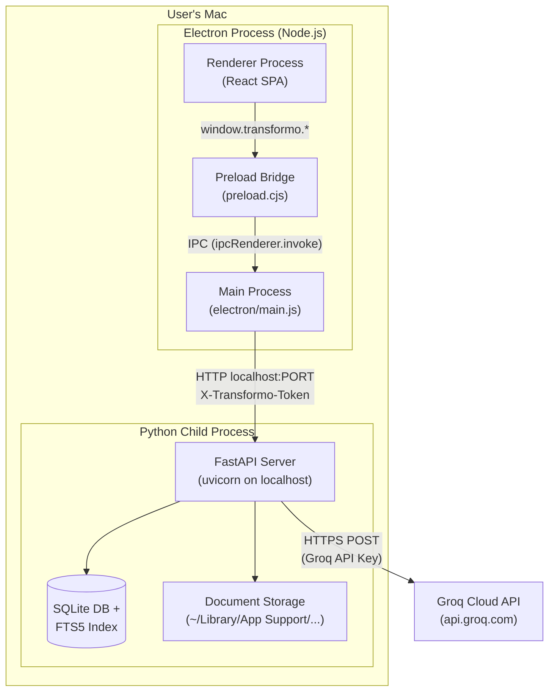
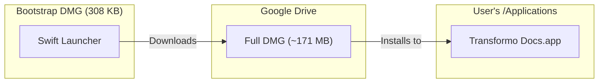
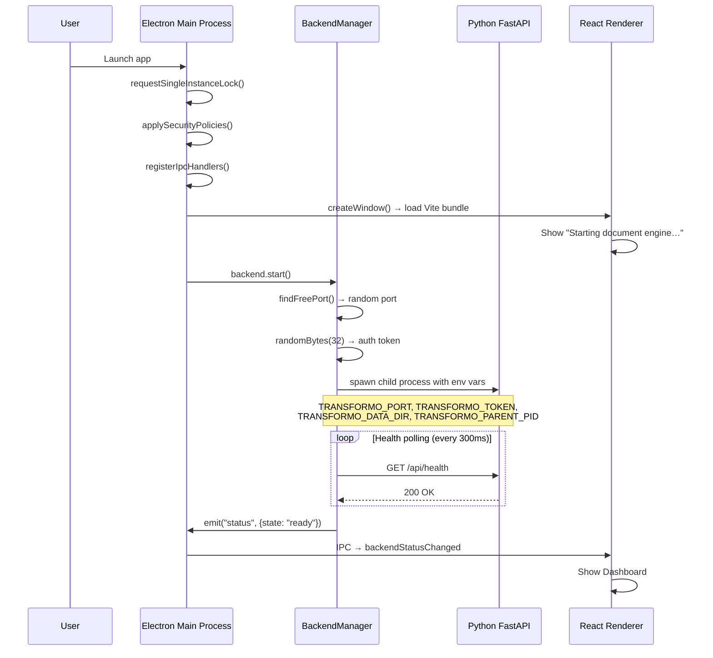
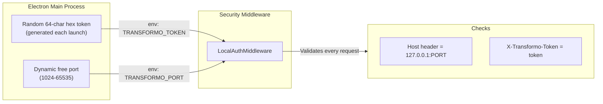
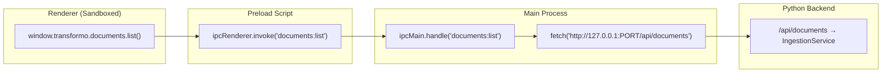
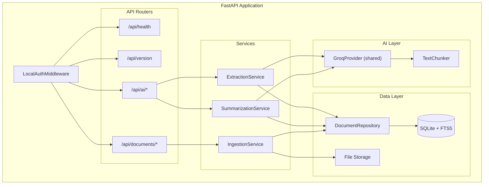
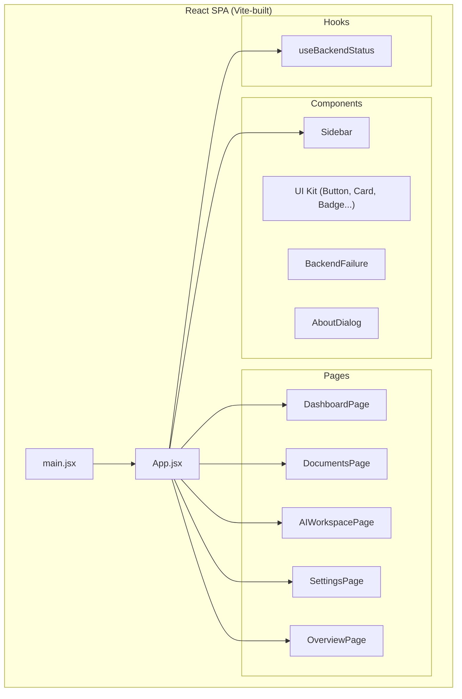
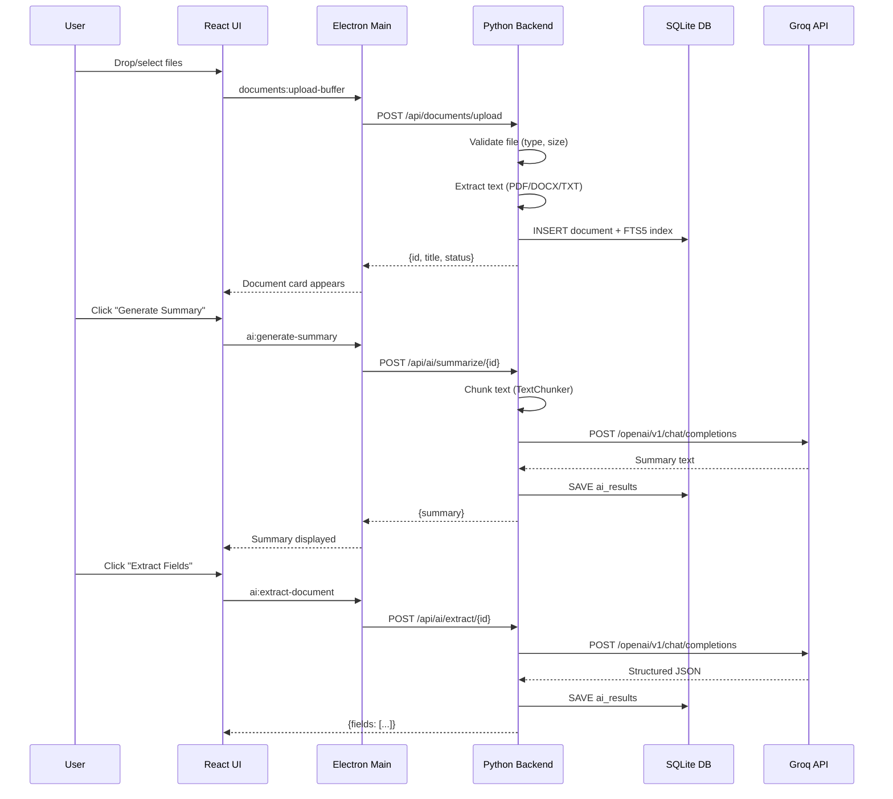
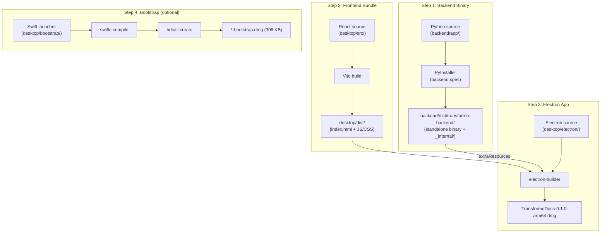

# Transformo Docs — System & Runtime Architecture

## High-Level Overview

Transformo Docs is a **macOS desktop application** for machine-readable document management. It combines an **Electron** shell (React frontend) with a **Python FastAPI** backend — both running locally on the user's Mac. AI features (summarization, extraction) are powered by **Groq Cloud API** over HTTPS.



---

## 1. Distribution & Installation

There are **two DMG installer options**, both targeting macOS 12+ on Apple Silicon (arm64):

### Option A: Full Offline DMG (~171 MB)
- File: [`TransformoDocs-0.1.0-arm64.dmg`](file:///Users/shreyashgolhani/Desktop/transformo-docs-project/desktop/release/TransformoDocs-0.1.0-arm64.dmg)
- Contains the complete `.app` bundle — Electron shell + PyInstaller backend binary
- Built by: `npm run desktop:dist:mac` (Vite build → electron-builder)

### Option B: Bootstrap DMG (308 KB)
- File: [`TransformoDocs-0.1.0-arm64-bootstrap.dmg`](file:///Users/shreyashgolhani/Desktop/transformo-docs-project/desktop/release/TransformoDocs-0.1.0-arm64-bootstrap.dmg)
- Contains a **native Swift launcher** ([`main.swift`](file:///Users/shreyashgolhani/Desktop/transformo-docs-project/desktop/bootstrap/main.swift)) that downloads the full DMG from Google Drive on first launch
- Designed for portals with < 50 MB upload limits



---

## 2. Application Startup Sequence

When the user double-clicks `Transformo Docs.app`:



### Key files in the startup chain:

| Step | File | Role |
|---|---|---|
| 1 | [`electron/main.js`](file:///Users/shreyashgolhani/Desktop/transformo-docs-project/desktop/electron/main.js) | Entry point — creates window, starts backend |
| 2 | [`electron/backend-manager.js`](file:///Users/shreyashgolhani/Desktop/transformo-docs-project/desktop/electron/backend-manager.js) | Spawns Python, manages lifecycle |
| 3 | [`electron/backend-command.js`](file:///Users/shreyashgolhani/Desktop/transformo-docs-project/desktop/electron/backend-command.js) | Resolves correct Python path (dev vs packaged) |
| 4 | [`electron/port.js`](file:///Users/shreyashgolhani/Desktop/transformo-docs-project/desktop/electron/port.js) | Finds a free TCP port |
| 5 | [`backend/app/__main__.py`](file:///Users/shreyashgolhani/Desktop/transformo-docs-project/backend/app/__main__.py) | Python entry — loads settings, starts uvicorn |
| 6 | [`backend/app/config.py`](file:///Users/shreyashgolhani/Desktop/transformo-docs-project/backend/app/config.py) | Reads env vars into `Settings` dataclass |
| 7 | [`backend/app/main.py`](file:///Users/shreyashgolhani/Desktop/transformo-docs-project/backend/app/main.py) | Creates FastAPI app, registers routes |

---

## 3. Security Model

The backend is **localhost-only** with per-launch authentication:



- **Port & token are never exposed to the renderer** — all HTTP calls go through the Electron main process
- [`security.py`](file:///Users/shreyashgolhani/Desktop/transformo-docs-project/backend/app/security.py): `LocalAuthMiddleware` validates `Host` header + `X-Transformo-Token` on every request
- Renderer sandbox is enabled (`contextIsolation: true`, `nodeIntegration: false`, `sandbox: true`)

---

## 4. IPC Communication Layer

The renderer (React) talks to the backend through a **three-hop chain**:



### IPC Channel Map

| Namespace | Channels | Backend Routes |
|---|---|---|
| `app:` | `get-info` | *(Electron-only, no backend call)* |
| `backend:` | `get-status`, `restart`, `health`, `status-changed` | `GET /api/health` |
| `documents:` | `select-and-import`, `upload-buffer`, `list`, `get`, `delete`, `stats` | `POST/GET/DELETE /api/documents/*` |
| `ai:` | `get-settings`, `update-settings`, `validate`, `set-consent`, `generate-summary`, `get-summary`, `extract-document`, `get-extraction`, `update-extraction`, `export-extraction` | `GET/POST /api/ai/*` |

Key files:
- [`shared/api.js`](file:///Users/shreyashgolhani/Desktop/transformo-docs-project/desktop/shared/api.js) — Channel name constants
- [`electron/preload.cjs`](file:///Users/shreyashgolhani/Desktop/transformo-docs-project/desktop/electron/preload.cjs) — Bridge (`contextBridge.exposeInMainWorld`)
- [`electron/ipc.js`](file:///Users/shreyashgolhani/Desktop/transformo-docs-project/desktop/electron/ipc.js) — Main process handlers (HTTP calls to backend)

---

## 5. Backend Architecture



### Backend modules:

| Module | Path | Purpose |
|---|---|---|
| **config** | [`config.py`](file:///Users/shreyashgolhani/Desktop/transformo-docs-project/backend/app/config.py) | `Settings` dataclass from env vars |
| **security** | [`security.py`](file:///Users/shreyashgolhani/Desktop/transformo-docs-project/backend/app/security.py) | Per-request auth middleware |
| **ingestion** | [`ingestion/`](file:///Users/shreyashgolhani/Desktop/transformo-docs-project/backend/app/ingestion) | Document upload, OCR, text extraction |
| **db** | [`db/`](file:///Users/shreyashgolhani/Desktop/transformo-docs-project/backend/app/db) | SQLite repository, FTS5 search, migrations |
| **ai** | [`ai/`](file:///Users/shreyashgolhani/Desktop/transformo-docs-project/backend/app/ai) | Groq provider, summarization, extraction, chunking |
| **api** | [`api/`](file:///Users/shreyashgolhani/Desktop/transformo-docs-project/backend/app/api) | FastAPI routers (health, documents, ai, version) |

### Shared GroqProvider

A **single `GroqProvider` instance** ([`groq_provider.py`](file:///Users/shreyashgolhani/Desktop/transformo-docs-project/backend/app/ai/groq_provider.py)) is shared between `SummarizationService` and `ExtractionService`. This ensures:
- API key changes via Settings UI apply to both services immediately
- Key is persisted to `TRANSFORMO_DATA_DIR/.env` (survives app restarts)

---

## 6. Frontend Architecture



### Page routing

The app uses **state-based routing** (no React Router). [`App.jsx`](file:///Users/shreyashgolhani/Desktop/transformo-docs-project/desktop/src/App.jsx) manages the current page via `useState`:

| Page | Component | What it does |
|---|---|---|
| `dashboard` | [`DashboardPage`](file:///Users/shreyashgolhani/Desktop/transformo-docs-project/desktop/src/pages/DashboardPage.jsx) | Overview stats, recent docs, quick actions |
| `documents` | [`DocumentsPage`](file:///Users/shreyashgolhani/Desktop/transformo-docs-project/desktop/src/pages/DocumentsPage.jsx) | Document list, search, upload, delete |
| `ai-workspace` | [`AIWorkspacePage`](file:///Users/shreyashgolhani/Desktop/transformo-docs-project/desktop/src/pages/AIWorkspacePage.jsx) | AI summaries + field extraction |
| `settings` | [`SettingsPage`](file:///Users/shreyashgolhani/Desktop/transformo-docs-project/desktop/src/pages/SettingsPage.jsx) | API key config, theme, privacy info |
| `overview` | [`OverviewPage`](file:///Users/shreyashgolhani/Desktop/transformo-docs-project/desktop/src/pages/OverviewPage.jsx) | Backend status + system health |

### Keyboard shortcuts: `⌘K` → Documents, `⌘,` → Settings, `⌘/` → About

---

## 7. Data Flow — Document Lifecycle



---

## 8. Data Storage Layout

All persistent data lives under `~/Library/Application Support/Transformo Docs/`:

```
~/Library/Application Support/Transformo Docs/
├── .env                     ← Groq API key (persisted by SettingsPage)
├── logs/
│   └── app.log              ← Electron file logger output
├── documents.db             ← SQLite database
│   ├── documents table      ← File metadata, status, text content
│   ├── documents_fts        ← FTS5 full-text search index
│   └── ai_results table     ← Summaries and extractions
└── storage/
    └── <uuid>/              ← Original uploaded files
        └── filename.pdf
```

> [!NOTE]
> In development mode, data is stored under `~/Library/Application Support/Transformo Docs Dev/` to keep it separate from the production installation.

---

## 9. Packaging Pipeline



### Build commands:

```bash
# 1. Package Python backend
cd backend && python -m PyInstaller backend.spec --noconfirm

# 2. Build Vite + create DMG
cd desktop && npm run desktop:dist:mac

# 3. (Optional) Build bootstrap DMG
bash desktop/bootstrap/build_bootstrap_dmg.sh
```

---

## 10. Technology Stack Summary

| Layer | Technology | Version |
|---|---|---|
| **Desktop Shell** | Electron | 44.x |
| **Frontend** | React + Vite | React 19, Vite 8 |
| **Styling** | Tailwind CSS | v4 |
| **Icons** | Lucide React | 1.59+ |
| **Backend** | Python + FastAPI + Uvicorn | Python 3.11, FastAPI latest |
| **Database** | SQLite + FTS5 | Built-in |
| **AI Provider** | Groq Cloud API | OpenAI-compatible SDK |
| **AI Model** | `openai/gpt-oss-120b` | (configurable in Settings) |
| **Doc Parsing** | python-docx, PyPDF2, lxml | — |
| **Packaging** | PyInstaller + electron-builder | — |
| **Bootstrap Installer** | Native Swift (AppKit) | — |
| **Platform** | macOS 12+ (Apple Silicon arm64) | — |
